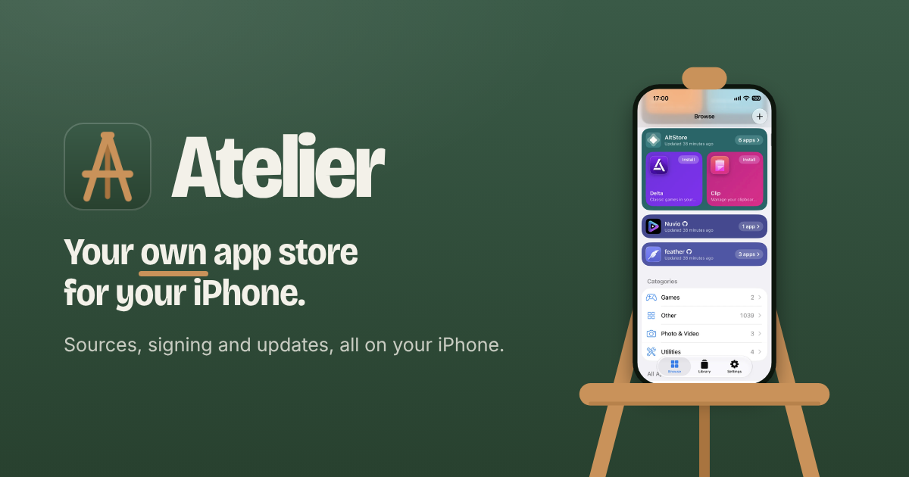
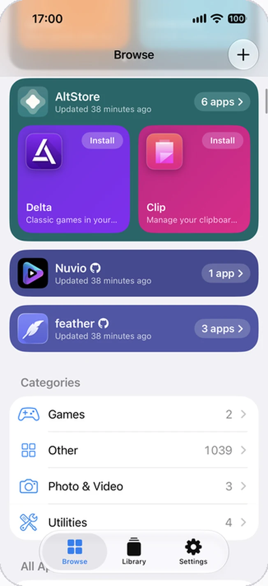
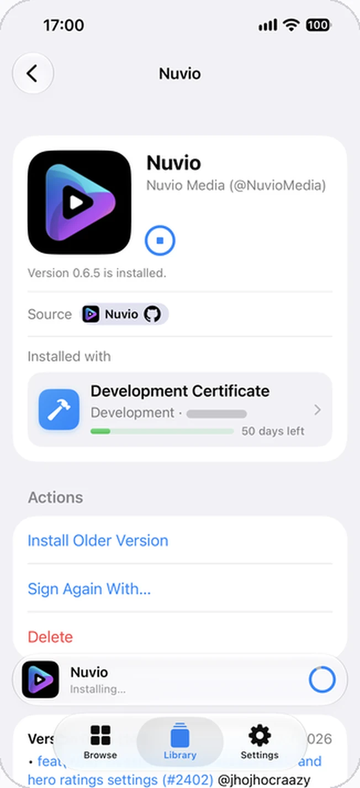
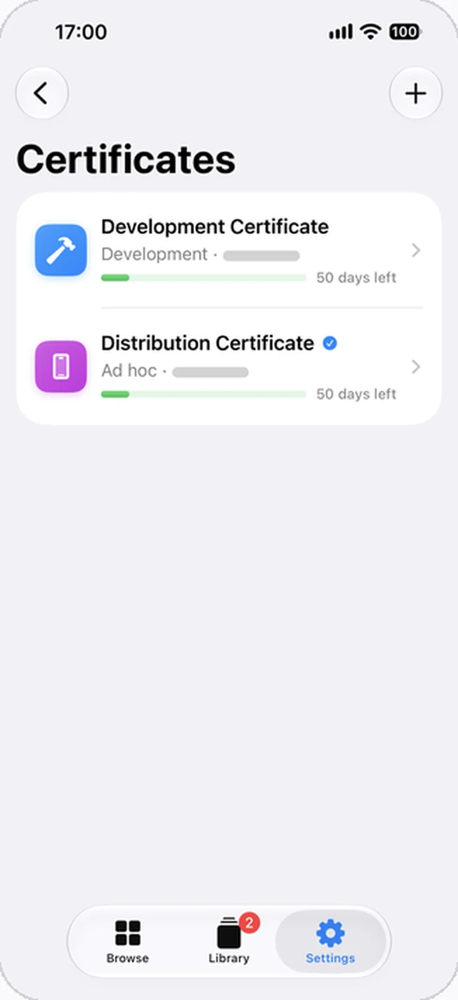

<p align="center">
  <a href="https://atelierstore.app"></a>
</p>

<p align="center">
  Add AltStore sources and GitHub repos, and Atelier downloads, signs, installs and updates their apps right on your iPhone, with your own certificate or Apple ID. No computer needed.
</p>

<p align="center">
  <a href="https://atelierstore.app"><b>Get Atelier</b></a>
  &nbsp;·&nbsp;
  <a href="#add-the-source">Add&nbsp;the&nbsp;source</a>
  &nbsp;·&nbsp;
  <a href="docs/install.md">Install&nbsp;guide</a>
  &nbsp;·&nbsp;
  <a href="https://atelierstore.app/donate">Donate</a>
</p>

<p align="center">
  <a href="https://github.com/atelierstore/Atelier/releases"></a>
  
  <a href="LICENSE"></a>
  <a href="https://github.com/atelierstore/Atelier/actions/workflows/atelier.yml"></a>
</p>

## Tap Install. Atelier does the rest.

Getting an app that isn't on the App Store onto your iPhone, known as sideloading, usually takes a computer, a cable and a list of steps that's easy to get wrong. In Atelier it's one button, the way the App Store does it:

1. **Download.** Atelier fetches the app from its source, and picks up where it left off if the connection drops.
2. **Sign.** It signs the app on your iPhone so iOS will run it. No jailbreak needed.
3. **Install.** iOS installs it, Atelier checks that it's there, and from then on keeps it up to date without losing its data.

<table>
  <tr>
    <td align="center" width="33%"></td>
    <td align="center" width="33%"></td>
    <td align="center" width="33%"></td>
  </tr>
  <tr>
    <td align="center"><b>Browse</b><br>Every source you add, with its apps and news.</td>
    <td align="center"><b>An app's page</b><br>Its source, the certificate it was installed with, and what you can do with it.</td>
    <td align="center"><b>Certificates</b><br>Each certificate's kind and the days it has left.</td>
  </tr>
</table>

## Features

- **Your sources, together.** Add AltStore sources and GitHub repos, and browse their apps and news in one place, with pre-releases if you want them.
- **Your certificate or Apple ID.** Import a certificate from a signing service, or sign in with a free or paid Apple ID, as AltStore and SideStore do. Add several Apple IDs, and free ones can add more new apps a week. With an Apple ID, or a certificate that comes with App Groups, widgets keep showing their app's data too.
- **Updates, ready ahead.** Atelier checks your sources in the background and downloads updates on Wi‑Fi, so Update only has to sign and install.
- **Re-sign everything.** Atelier checks with Apple that your certificate is still valid. When it expires or Apple revokes it, Re-sign All signs your apps again with one that works and installs them over the old ones.
- **Installs in the background.** A one-time setup lets Atelier install apps and updates without iOS's alert, even after you leave it. It needs Wi‑Fi and the LocalDevVPN app.
- **Private and open.** Signing happens on your iPhone, and your certificate isn't uploaded anywhere. Atelier is free and open source under the GPL-3.0.

And there's more: install a second copy of an app with its own data, go back to an older version, see every install in Install History, and open AltStore, SideStore and Feather links and files. Atelier keeps itself up to date too.

## Get Atelier

Atelier can't be on the App Store, which doesn't allow apps that install other apps. So you install it once yourself, signed for your iPhone, and from then on it updates itself.

- **New to sideloading?** [atelierstore.app](https://atelierstore.app) walks you through it: it signs Atelier with your certificate and installs it, and Atelier opens with the certificate ready.
- **Already sideload?** Get the unsigned IPA from [Releases](https://github.com/atelierstore/Atelier/releases) or the [sideload page](https://atelierstore.app/sideload), and sign it with Sideloadly, Feather, AltStore, SideStore or any other signer. The [install guide](docs/install.md) has the steps.

Atelier needs iOS 17 or later.

### Add the source

Atelier's own source lists every release, so AltStore-compatible apps can show its updates:

```
https://raw.githubusercontent.com/atelierstore/Atelier/source/source.json
```

On your iPhone, [open it in Atelier](https://atelierstore.app/source?url=https%3A%2F%2Fraw.githubusercontent.com%2Fatelierstore%2FAtelier%2Fsource%2Fsource.json). Atelier's releases are pre-releases for now, so keep Include Pre-releases on for this source.

## Status

Atelier is in alpha. Each [release](https://github.com/atelierstore/Atelier/releases) lists what's new and its known limits. If Atelier is useful to you, you can [support it on Ko-fi](https://atelierstore.app/donate).

## Development

### Layout

- `Atelier/`: the SwiftUI app (iOS 17 and later), with its pairing Live Activity (`LiveActivity/`) and the App Groups library it puts in apps it signs with an Apple ID (`AppGroups/`).
- `Packages/AtelierKit/`: everything else, one module per concern, each with its own tests:
  - `SourceKit`: AltStore source models and parsing, store links (`atelier://`, and AltStore's, SideStore's and Feather's schemes) and conditional fetching.
  - `GitHubKit`: GitHub repos as sources (each release with an IPA is a version) and GitHub sign-in.
  - `CertKit`: certificates, provisioning profiles and Apple IDs: parsing, storage, and checking with Apple that a certificate is still valid.
  - `AppleIDKit`: the anisette servers an Apple ID sign-in goes through.
  - `SigningKit`: on-device signing with zsign: unpacks an IPA, signs the app and everything nested in it with the user's certificate, and repacks it.
  - `InstallKit`: the install routes, iOS's install alert through a loopback server and manifest links (route B) and direct installs through idevice (route A), and the checks that an app is installed.
  - `DownloadKit`: IPA downloads through a background `URLSession` (resumable, retried, and checked against the source's size, ZIP layout and optional `sha256`).
  - `AtelierCore`: persistence (SwiftData), the user's sources (`SourceLibrary`: add, refresh, remove, kept for offline use) and the download, sign and install pipeline.
- `Packages/IDeviceBridge/`: [idevice](https://github.com/jkcoxson/idevice) (MIT) built from source with Atelier's pairing host, device helpers and Apple ID calls (through [isideload](https://github.com/nab138/isideload), MIT), as `IDevice.xcframework`.
- `project.yml`: the XcodeGen spec the Xcode project is generated from. The `.xcodeproj` isn't committed.
- `infra/manifest-worker/`: the HTTPS manifest endpoint route B installs need (a Cloudflare Worker).
- `infra/website/`: Atelier's website, static pages served by a second Cloudflare Worker: the home page, with the ways to install Atelier, the sideload page (`/sideload`) with its unsigned IPA and its source for people who sign it themselves, and `https://` pages for Atelier's install, source, app and search links (`/install?url=…`, `/source?url=…`, `/viewapp?bundleid=…`, `/search?q=…`), which open the `atelier://` links from places that don't open them, such as chat apps, and show the app or source, which the Worker reads from the IPA or the source; see [its README](infra/website/README.md).
- `scripts/sign_ipa.py`: signs a built app with a certificate and profile, the way Feather does. CI uses it.
- `scripts/update_source.py`, `scripts/publish_release.py` and `release/`: the release pipeline. Each pull request adds its line to the next release's notes (`release/notes/next.md`), merging a release's notes (`release/notes/<tag>.md`) tags it, and the tag builds the unsigned IPA and publishes it with Atelier's own source; see [docs/install.md](docs/install.md#publishing-a-release-maintainers).

### Build

On a Mac with Xcode 26 or later and [rustup](https://rustup.rs):

```sh
brew install xcodegen
rustup target add aarch64-apple-ios
Packages/IDeviceBridge/build-rust.sh   # idevice, as IDevice.xcframework
xcodegen generate
open Atelier.xcodeproj
```

Package tests: `cd Packages/AtelierKit && swift test`. Everything but the SwiftData store, the loopback server and zsign itself also builds and tests on Linux; there, SigningKit's tests run the signing pipeline with a stand-in for zsign, and the tests that sign real binaries and check them with `codesign` run only on a Mac with Xcode.

### CI

CI runs on GitHub Actions for each new commit on a pull request into main, and for each push to main (the *Atelier* workflow, `.github/workflows/atelier.yml`):

- On Linux, it runs the Workers' and the release scripts' tests. On a Mac, it runs the package tests, builds `Atelier-unsigned.ipa`, and signs a copy as `Atelier.ipa` with the Signulous certificate in the repo's secrets (`build.yml`, which says how to add them).
- Both IPAs go to the website, which keeps them for 7 days at unlisted addresses ([Builds](infra/website/README.md#builds)). The run's summary links the unsigned one and the link that installs it with Atelier. The signed one's links, which install it from Safari, are only in the website's build records, as its profile lists the maintainer's iPhones. The run also keeps `Atelier-unsigned.ipa` for 14 days, for anyone signed in to GitHub.
- A build has the last release's version, and 1000 plus the number of commits as its build number, so Atelier counts it as newer than that release and than the builds made before the repo was public.
- A pull request that only changes docs, release notes, the Workers or the release scripts runs just their checks and builds no IPA.
- Builds take `IDevice.xcframework` and SwiftPM's clones from caches that main's builds keep, so a pull request that changes `Packages/IDeviceBridge` builds it from source until it's merged.
- Pull requests from forks get none of the repo's secrets, so their builds aren't signed, and they wait for a maintainer's approval before they run.

## License

Atelier is licensed under GPL-3.0-only. See [LICENSE](LICENSE), and [THIRD_PARTY_NOTICES.md](THIRD_PARTY_NOTICES.md) for the open source projects it builds on.
