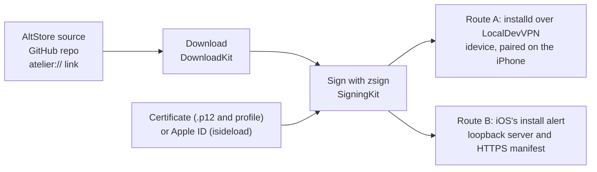

<p align="center">
  
</p>

<h1 align="center">Atelier</h1>

<p align="center">
  An AltStore-compatible app store for iOS that signs and installs on the iPhone itself,<br>
  with a free or paid Apple ID or your own certificate. No computer at any step.
</p>

<p align="center">
  <a href="https://github.com/atelierstore/Atelier/releases"></a>
  
  <a href="LICENSE"></a>
  <a href="https://github.com/atelierstore/Atelier/actions/workflows/atelier.yml"></a>
</p>

<p align="center">
  <a href="https://atelierstore.app">Website</a>
  &nbsp;·&nbsp;
  <a href="https://github.com/atelierstore/Atelier/releases">Releases</a>
  &nbsp;·&nbsp;
  <a href="docs/install.md">Install&nbsp;guide</a>
  &nbsp;·&nbsp;
  <a href="https://github.com/atelierstore/atelier-install">atelier-install</a>
</p>

Atelier is a SwiftUI app for iOS 17 and later. It reads AltStore sources and GitHub releases, signs IPAs with zsign on the device, and installs them either through iOS's install alert or straight through installd, over a pairing the iPhone makes with Atelier itself. Under it are Swift packages that also build and test on Linux, and a Rust bridge built from idevice and isideload. It's in alpha: each [release](https://github.com/atelierstore/Atelier/releases) lists its known limits.

<table>
  <tr>
    <td align="center" width="33%"><br><sub>Browse</sub></td>
    <td align="center" width="33%"><br><sub>An app's page</sub></td>
    <td align="center" width="33%"><br><sub>Certificates</sub></td>
  </tr>
</table>

## Highlights

### On the iPhone

- **No computer, ever.** On iOS 27, the iPhone pairs with Atelier itself (Developer Mode's device-initiated pairing, with idevice's RemotePairing host), and Atelier then talks to installd through LocalDevVPN at 10.7.0.1. With [atelier-install](#first-install), even Atelier's own first install needs only App Store apps.
- **Free Apple ID signing, built in.** A GrandSlam sign-in through isideload with anisette v3 data, failing over across a list of servers or using your own, then the developer calls Xcode makes for the certificate, the device, App IDs and profiles. Several Apple IDs at once give 10 more new apps a week each. Profiles are renewed through misagent two days before they lapse, with no download and no reinstall, and Atelier renews its own too.
- **Silent installs and automatic updates.** Direct installs skip iOS's alert and keep going after you leave Atelier. A `BGProcessingTask` refreshes your sources and installs updates by itself.
- **Your data and your Home Screen survive.** iOS won't upgrade an app signed for another App ID, so Atelier copies its data container out through house_arrest, reinstalls it, puts the data back, and writes the Home Screen layout back with the app in its old spot. Offload works the same way: the app goes, its data and its spot stay.
- **Custom Install.** Side-by-side copies of any app under new bundle IDs, each with its own name, icon tint or picture, reported version and URL schemes.
- **App Groups that work.** Under an Apple ID, Atelier registers each app's own App Group names. With a certificate that comes with App Groups, it gives each app a folder inside one. Widgets and extensions keep seeing their app's data.
- **Revocation checks.** Atelier asks Apple's OCSP responders about each certificate and only believes answers signed by the issuer. When one is revoked or expires, Re-sign All moves every app to a certificate that still works.
- **Speaks everyone's formats.** AltStore sources, GitHub repos, `atelier://` links and AltStore's, SideStore's and Feather's, and `.ipa`, `.tipa` and `.mobileprovision` files. Go back to an older version, pick a build when a release ships several, and see every install in Install History.

### Under the hood

- **GitHub releases as sources.** `owner/repo` is enough, private repos included once you sign in to GitHub. Atelier reads each IPA's `Info.plist` and icon with HTTP range requests on the ZIP's central directory, so it never downloads an app just to list it.
- **Route B without trusting a server.** The signed IPA is served from 127.0.0.1 only. A stateless Cloudflare Worker serves the HTTPS manifest iOS insists on, and sees the app's bundle ID, name and version, never the IPA. iOS 27 doesn't tell a sandboxed app whether an install worked, so Atelier adds a URL scheme of its own to each app it signs and waits for `canOpenURL` to answer.
- **Rust inside.** idevice and isideload are built with Atelier's pairing host into one `IDevice.xcframework`, so a single idevice serves pairing, installs and Apple's sign-in.
- **A Live Activity for pairing,** with the code in the Dynamic Island, while a loop of silence under the audio background mode keeps Atelier running as you type the code in Settings.
- **zsign in WebAssembly.** The website compiles the same zsign commit, with OpenSSL's libcrypto, to WebAssembly, and signs Atelier in the browser with the visitor's own certificate.
- **Linux-friendly packages.** Everything but the SwiftData store, the loopback server and zsign itself builds and tests on Linux, with a stand-in for zsign.

## How it works



`AtelierCore` runs that pipeline and keeps its state in SwiftData. Route A installs silently, in the background too, once the iPhone is paired. Route B needs nothing set up, and iOS asks before each install.

## First install

Atelier can't be on the App Store, so its first install is signed with your own certificate or Apple ID. After that, it updates itself from its own source.

- **From the iPhone alone, with [atelier-install](https://github.com/atelierstore/atelier-install).** A WebAssembly program of about 3 MB, written in Rust, that runs in rootshell, a terminal app on the App Store. It pairs the iPhone with itself by sending iOS 27's Bonjour announcement as an mDNS packet it builds by hand, signs in with a free Apple ID, signs Atelier, and installs it through LocalDevVPN. It hands Atelier the pairing and the signing identity, so Atelier opens already paired and signed in. It's a test build for now.
- **From the website.** [atelierstore.app](https://atelierstore.app) checks your `.p12` and profile, signs Atelier in the browser and installs it through iOS's alert, on the iPhone or from a computer through a QR code.
- **With any signer.** The unsigned IPA is on [Releases](https://github.com/atelierstore/Atelier/releases). Sign it with Sideloadly, Feather, AltStore or SideStore, as the [install guide](docs/install.md) explains.

Atelier's own source, for its updates (keep Include Pre-releases on while its releases are pre-releases):

```
https://raw.githubusercontent.com/atelierstore/Atelier/source/source.json
```

## Repository layout

- `Atelier/`: the SwiftUI app, with its pairing Live Activity (`LiveActivity/`) and the App Groups library it puts in apps it signs with an Apple ID (`AppGroups/`).
- `Packages/AtelierKit/`: everything else, one module per concern, each with its own tests:
  - `SourceKit`: AltStore source models and parsing, store links (`atelier://`, and AltStore's, SideStore's and Feather's schemes) and conditional fetching.
  - `GitHubKit`: GitHub repos as sources (each release with an IPA is a version) and GitHub sign-in.
  - `CertKit`: certificates, provisioning profiles and Apple IDs: parsing, storage, and OCSP checks.
  - `AppleIDKit`: the anisette servers an Apple ID sign-in goes through.
  - `SigningKit`: on-device signing with zsign: unpacks an IPA, signs the app and everything nested in it with the user's certificate, and repacks it.
  - `InstallKit`: the install routes (route A through idevice, route B through a loopback server and manifest links), install checks, app data and the Home Screen layout.
  - `DownloadKit`: IPA downloads through a background `URLSession` (resumable, retried, and checked against the source's size, ZIP layout and optional `sha256`).
  - `AtelierCore`: persistence (SwiftData), the user's sources (`SourceLibrary`: add, refresh, remove, kept for offline use) and the download, sign and install pipeline.
- `Packages/IDeviceBridge/`: [idevice](https://github.com/jkcoxson/idevice) (MIT) built from source with Atelier's pairing host, device helpers and Apple ID calls (through [isideload](https://github.com/nab138/isideload), MIT), as `IDevice.xcframework`.
- `project.yml`: the XcodeGen spec the Xcode project is generated from. The `.xcodeproj` isn't committed.
- `infra/manifest-worker/`: the HTTPS manifest endpoint route B installs need (a Cloudflare Worker).
- `infra/website/`: Atelier's website, static pages served by a second Cloudflare Worker: the home page, with the ways to install Atelier, the sideload page (`/sideload`) with its unsigned IPA and its source for people who sign it themselves, and `https://` pages for Atelier's install, source, app and search links (`/install?url=…`, `/source?url=…`, `/viewapp?bundleid=…`, `/search?q=…`), which open the `atelier://` links from places that don't open them, such as chat apps, and show the app or source, which the Worker reads from the IPA or the source; see [its README](infra/website/README.md).
- `scripts/sign_ipa.py`: signs a built app with a certificate and profile, the way Feather does. CI uses it.
- `scripts/update_source.py`, `scripts/publish_release.py` and `release/`: the release pipeline (see [Releases](#releases)).

## Building

On a Mac with Xcode 26 or later and [rustup](https://rustup.rs):

```sh
brew install xcodegen
rustup target add aarch64-apple-ios
Packages/IDeviceBridge/build-rust.sh   # idevice, as IDevice.xcframework
xcodegen generate
open Atelier.xcodeproj
```

Package tests: `cd Packages/AtelierKit && swift test`. Everything but the SwiftData store, the loopback server and zsign itself also builds and tests on Linux; there, SigningKit's tests run the signing pipeline with a stand-in for zsign, and the tests that sign real binaries and check them with `codesign` run only on a Mac with Xcode.

## CI

CI runs on GitHub Actions for each new commit on a pull request into main, and for each push to main (the *Atelier* workflow, `.github/workflows/atelier.yml`):

- On Linux, it runs the Workers' and the release scripts' tests. On a Mac, it runs the package tests, builds `Atelier-unsigned.ipa`, and signs a copy as `Atelier.ipa` with the Signulous certificate in the repo's secrets (`build.yml`, which says how to add them).
- Both IPAs go to the website, which keeps them for 7 days at unlisted addresses ([Builds](infra/website/README.md#builds)). The run's summary links the unsigned one and the link that installs it with Atelier. The signed one's links, which install it from Safari, are only in the website's build records, as its profile lists the maintainer's iPhones. The run also keeps `Atelier-unsigned.ipa` for 14 days, for anyone signed in to GitHub.
- A build has the last release's version, and 1000 plus the number of commits as its build number, so Atelier counts it as newer than that release and than the builds made before the repo was public.
- A pull request that only changes docs, release notes, the Workers or the release scripts runs just their checks and builds no IPA.
- Builds take `IDevice.xcframework` and SwiftPM's clones from caches that main's builds keep, so a pull request that changes `Packages/IDeviceBridge` builds it from source until it's merged.
- Pull requests from forks get none of the repo's secrets, so their builds aren't signed, and they wait for a maintainer's approval before they run.

## Releases

Each pull request adds its line to the next release's notes (`release/notes/next.md`). Merging a release's notes (`release/notes/<tag>.md`) tags it, and the tag builds the unsigned IPA and publishes it with Atelier's own source. The details are in [docs/install.md](docs/install.md#publishing-a-release-maintainers).

## License

GPL-3.0-only. See [LICENSE](LICENSE) and [THIRD_PARTY_NOTICES.md](THIRD_PARTY_NOTICES.md).
